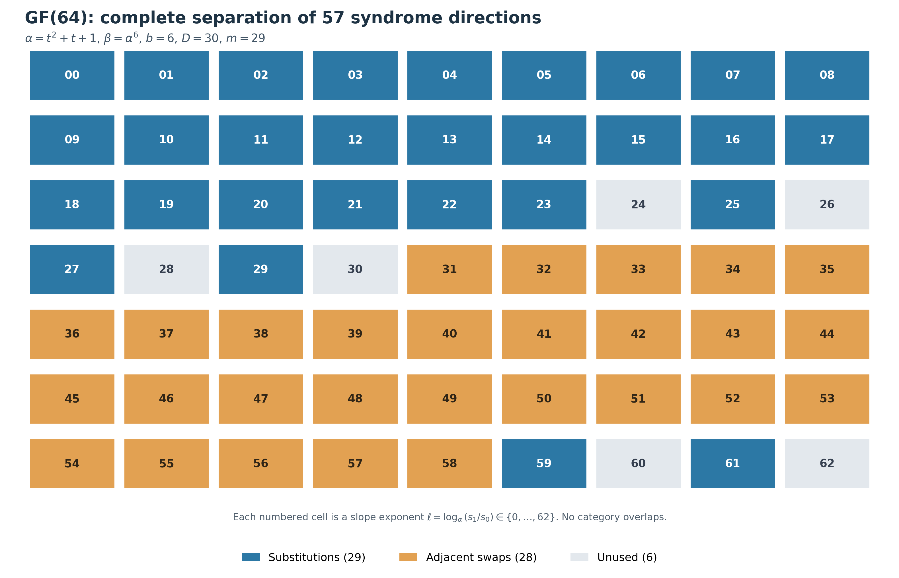
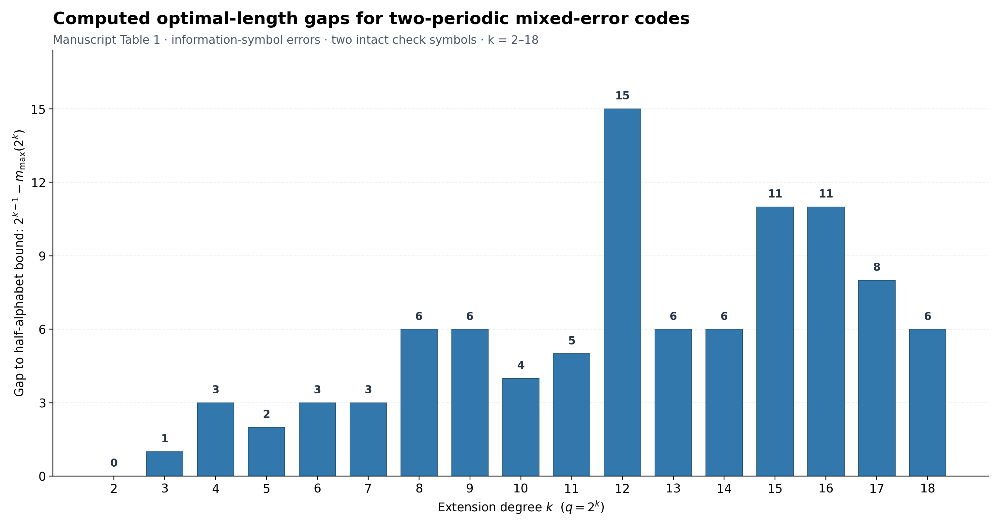

# Reproducibility Code for Two-Periodic Mixed-Error Codes

**Software author:** Malihe Aliasgari  
**Associated manuscript:** *Adjacent-Transposition Syndromes and Sharp Length Bounds for Two-Periodic Mixed-Error Codes over Finite Fields*

This repository contains Python programs and saved output logs supporting the mathematical and computational results in the associated manuscript. The verification software was developed by **Malihe Aliasgari**. Software authorship is distinct from the authorship of the research manuscript.

## Research Visualizations

### GF(64): separation of substitution and adjacent-transposition syndromes



*For the construction with* `alpha = t^2 + t + 1`, `beta = alpha^6`, *and 29 information symbols, all 57 allowed error directions are distinct: 29 substitution directions (blue), 28 adjacent-swap directions (orange), and six unused nonzero projective directions (gray). The two check symbols are assumed intact for this 29-information-symbol code.*

### Computed optimal-length gaps for extension degrees 2–18



*The bars show* `2^(k-1) - m_max(2^k)` *for the two-periodic family, as reported in Table 1. Here* `m_max` *is the maximum number of information symbols when the two check symbols are intact. The plotted values are computed optima for the specified family, not bounds for all possible error-correcting codes.*

The image files belong in the repository's `figures/` folder under the exact filenames above. The plots will not display until those files are uploaded separately to GitHub.

## Verification Programs

**Requirements:** Python **3.8 or later**; Python standard library only. No external packages, datasets, or network connection are required.

| Program | Manuscript results verified | Command | Reference runtime |
| --- | --- | --- | --- |
| `GF64_Sharp_Bound_Verification.py` | Theorem 5.2: sharp `m_max(64) = 29`, the 13 candidate `(b, D)` pairs and cyclotomic-polynomial GCD certificates, and the even-length construction. | `python3 GF64_Sharp_Bound_Verification.py` | Approximately 1 second |
| `Generalized_Two_Periodic_Bounds_Verification.py` | Table 1 for `2 <= k <= 18`, using the short-exponent reduction from Lemma 5.3 for the larger fields. | `python3 Generalized_Two_Periodic_Bounds_Verification.py 18` | Approximately 19 seconds |
| `Two_Periodic_Exhaustive_Verification.py` | Tables 1 and 2 through `k = 10` by default (optional `k = 12`), checks related to Proposition 5.9 and Lemma 4.1/Corollary 4.2, GF(64) encoding/decoding and codon examples, the `k >= 29` threshold, and a numerical check of Equation (30). | `python3 Two_Periodic_Exhaustive_Verification.py 10` | Approximately 10 seconds |

The runtimes above were observed under Python 3.13.5 in a reference environment and will vary by computer. On systems where Python 3 is invoked with `python`, replace `python3` accordingly.

For an extended exhaustive search through `k = 12`, run:

```bash
python3 Two_Periodic_Exhaustive_Verification.py 12
```

This extended run took approximately 96 seconds in the reference environment.

## Saved Outputs

The `outputs/` directory contains console logs from the three programs, plus the optional `k = 12` exhaustive run. Reviewers can compare their own results with these files.

To rerun the programs and save output:

```bash
python3 GF64_Sharp_Bound_Verification.py > outputs/GF64_Sharp_Bound_Verification.txt 2>&1
python3 Generalized_Two_Periodic_Bounds_Verification.py 18 > outputs/Generalized_Two_Periodic_Bounds_Verification.txt 2>&1
python3 Two_Periodic_Exhaustive_Verification.py 10 > outputs/Two_Periodic_Exhaustive_Verification.txt 2>&1
```

The provided output logs also record measured elapsed times. Ordinary shell redirection does not add timing lines automatically.

## Computational Scope and Precision

- The GF(64) sharp-bound certificates and finite-field searches use **exact binary-polynomial arithmetic**, without randomized or floating-point computation.
- The generalized program uses the **proved short-exponent restriction in Lemma 5.3**. Its calculation through `k = 18` is not an unrestricted enumeration of all field parameters and lengths.
- The exhaustive program enumerates primitive elements up to Frobenius conjugacy, admissible two-periodic parameters, and candidate lengths. Its checks of **Proposition 5.9** are computational corroboration, not a replacement for the proof.
- The **Equation (30)** check uses deterministically seeded pseudorandom subsets and floating-point complex arithmetic. It is a numerical spot-check of the conjugated-character identity, **not** a proof of the asymptotic character-sum estimate.
- The threshold check evaluates the displayed inequality numerically for `k = 26, ..., 32`; the general threshold claim is justified in the manuscript.
- Result numbers correspond to the **26-page November 2026 manuscript preview** and should be checked again if the final journal layout changes theorem, table, or equation numbering.

## Repository Contents

```text
GF64_Sharp_Bound_Verification.py
Generalized_Two_Periodic_Bounds_Verification.py
Two_Periodic_Exhaustive_Verification.py
README.md
LICENSE
CITATION.cff
SHA256SUMS
outputs/
figures/
    GF64_Syndrome_Separation.png
    Computed_Optimal_Length_Gaps.png
```

The repository is intended for verification software, figures, and saved results; the manuscript PDF, manuscript LaTeX source, temporary editing scripts, and cache folders are excluded.

## Citation and Archiving

Please cite the archived software release when reusing the verification code. The software author is **Malihe Aliasgari**. The `CITATION.cff` file records the software citation metadata.

Once the repository is public and the verified files are present, a GitHub release (for example, `v1.0.0`) can be archived through Zenodo. Add the resulting repository URL and **actual minted DOI** to the manuscript's Data Availability Statement. Do not insert a DOI before one has been issued.

## License

MIT License; see [`LICENSE`](LICENSE).  
Copyright (c) 2026 Malihe Aliasgari.
